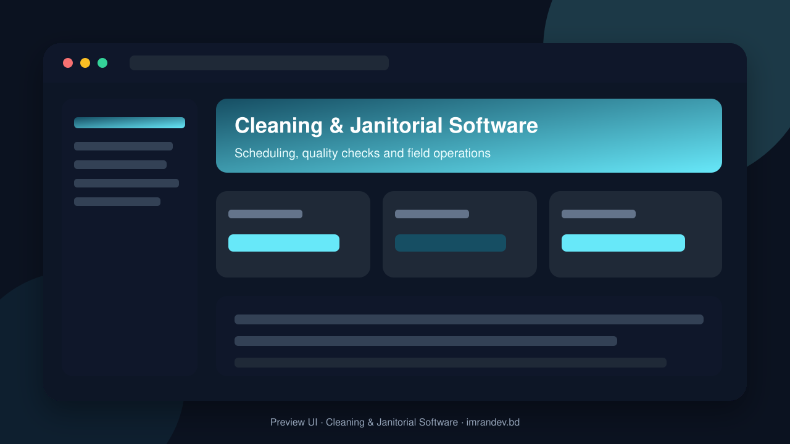
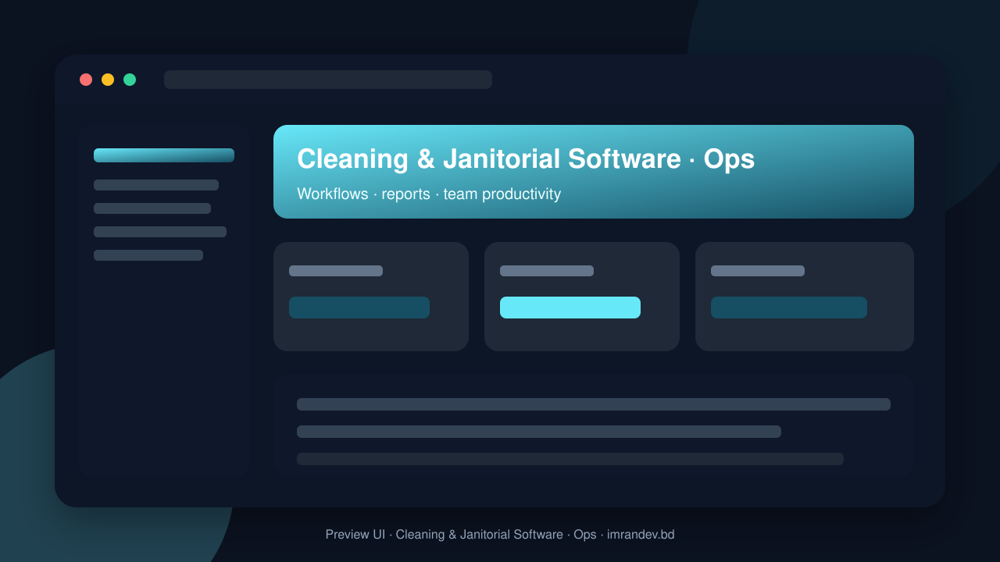

<p align="center">
  
</p>

<h1 align="center">Cleaning & Janitorial Software</h1>

<p align="center"><strong>Scheduling, quality checks and field operations</strong></p>

<p align="center">
  <a href="https://github.com/imranbru99/cleaning-janitorial-service-software"></a>
  
  
</p>

---

## Overview

**Cleaning & Janitorial Software** is a complete business application focused on real operational workflows. This README lists the full feature surface so GitHub visitors and search engines can understand every capability of the product.

## Product preview

| Dashboard | Operations |
| :---: | :---: |
|  |  |

## Complete feature list

### Product modules & capabilities

- Cleaning and Janitorial Service Management Platform
- Complete Enterprise Business Operating System
- DevOps Engineer
- Security Engineer
- AI Integration Engineer
- QA Automation Engineer
- Cleaning and Janitorial Service Management
- Bookings
- Invoices
- Payments
- Contracts
- Attendance devices
- Inventory
- Advanced reporting
- AI analytics

### Admin / Filament resources

- Asset
- Attendance Log
- Booking
- Branch
- Cleaning Job
- Contract
- Customer
- Employee
- Expense
- Inspection
- Inventory Item
- Invoice
- Lead
- Payment
- Quotation
- Service
- Subscription Plan
- Supplier
- Support Ticket
- Tenant Module

### Domain models

- Ai Usage Log
- Asset
- Attendance Log
- Automation Execution
- Automation Rule
- Blog Post
- Booking
- Booking Item
- Branch
- Cleaning Job
- Cms Page
- Complaint
- Contract
- Corrective Action
- Customer
- Customer Address
- Customer Contact
- Department
- Document
- Employee
- Employee Certification
- Employee Skill
- Expense
- Expense Category
- Faq
- Feedback
- Inspection
- Inspection Answer
- Inspection Category
- Inspection Question
- Inspection Template
- Inventory Item
- Invoice
- Invoice Item
- Job Assignment
- Job Attachment
- Job Status History
- Job Task
- Job Time Log
- Lead
- Leave Request
- Maintenance Record
- Module
- Payment
- Payroll Record
- Purchase Order
- Quotation
- Quotation Item
- Recurring Booking
- Schedule

### HTTP / API controllers

- Auth APIs & screens
- Booking APIs & screens
- Customer APIs & screens
- Inspection APIs & screens
- Invoice APIs & screens
- Job APIs & screens
- Marketing APIs & screens
- Portal APIs & screens
- Service APIs & screens

### Detailed feature requirements delivered

- APPLICATION IDENTITY
- REQUIRED TECHNOLOGY STACK
- REQUIRED CUSTOM PACKAGES
- PACKAGE INTEGRATION RULES
- COMPLETE MODULAR SYSTEM
- USER TYPES AND ROLE MANAGEMENT
- SAAS AND MULTI-TENANCY ARCHITECTURE
- PUBLIC WEBSITE AND MARKETING PAGES
- CORE BUSINESS MODULES
- Below 70: Failed.
- AI-POWERED FEATURES
- AUTOMATION ENGINE
- MAPS AND LOCATION MANAGEMENT
- DOCUMENT MANAGEMENT
- MULTILINGUAL SYSTEM
- SUBSCRIPTION AND SAAS BILLING
- API AND THIRD-PARTY INTEGRATIONS
- DATABASE ARCHITECTURE
- DEMO ACCOUNT AND SAMPLE DATA
- Email: superadmin@cleaningdemo.test
- Password: Demo@12345
- Email: owner@cleaningdemo.test
- Email: operations@cleaningdemo.test
- Email: branch@cleaningdemo.test
- Email: inspector@cleaningdemo.test
- Email: supervisor@cleaningdemo.test
- Email: cleaner@cleaningdemo.test
- Email: accountant@cleaningdemo.test
- Email: customer@cleaningdemo.test
- UI/UX DESIGN REQUIREMENTS
- Primary: Deep Navy Blue.
- Secondary: Teal.
- Accent: Emerald.
- Background: Soft Light Gray.
- Cards: White.
- Text: Dark Slate.
- Warnings: Amber.
- Errors: Red.
- SECURITY REQUIREMENTS
- TESTING AND QUALITY ASSURANCE
- PERFORMANCE REQUIREMENTS
- README AND DOCUMENTATION
- DEVELOPMENT WORKFLOW
- PHASE 1: Repository and requirements audit.
- PHASE 2: Architecture and database design.
- PHASE 3: Authentication and multi-tenancy.
- PHASE 4: Roles and permissions.
- PHASE 5: Module management engine.
- PHASE 6: Public website and CMS.
- PHASE 7: CRM and service catalog.
- PHASE 8: Booking and scheduling.
- PHASE 9: Employee and attendance management.
- PHASE 10: Job execution and mobile workflows.
- PHASE 11: Quality inspection and corrective actions.
- PHASE 12: Customer portal and contracts.
- PHASE 13: Quotations, invoicing and payments.
- PHASE 14: Inventory, procurement and assets.
- PHASE 15: HR, payroll and expenses.
- PHASE 16: AI and automation.
- PHASE 17: Reports and analytics.
- PHASE 18: SaaS subscriptions.
- PHASE 19: API and integrations.
- PHASE 20: Demo data and demo accounts.
- PHASE 21: Testing and security audit.
- PHASE 22: Performance optimization.
- PHASE 23: Documentation.
- PHASE 24: Production deployment preparation.
- CRITICAL DEVELOPMENT RULES
- FINAL INSTRUCTION TO THE AI AGENT

### Platform capabilities

- Multi-role ready structure for operators, managers and admins
- Database migrations and seeders for demo-ready local setup
- Laravel architecture with services/controllers/models separation
- Responsive UI foundation (Blade / Filament where enabled)
- Environment-based config for local and production databases
- GitHub-ready documentation with visual product previews

## Tech stack

- PHP 8.2+ / Laravel
- Filament admin resources (where enabled)
- Vite asset pipeline
- SQLite/MySQL-ready database layer
- Migrations, seeders, and test-ready structure

## Quick start

```bash
git clone https://github.com/imranbru99/cleaning-janitorial-service-software.git
cd cleaning-janitorial-service-software
composer install
cp .env.example .env
php artisan key:generate
php artisan migrate --seed
npm install && npm run build
php artisan serve
```

## Repository

- GitHub: https://github.com/imranbru99/cleaning-janitorial-service-software
- Developer: **Imran Ahmed** · https://imrandev.bd

---

## 🤝 Let's Connect & Collaborate

I am open to **Senior Remote Full-Stack Roles**, AI Platform Architecture Contracts, and Enterprise Technical Advisory.

**Timezone:** UTC+6 (Dhaka / Rangpur, Bangladesh) — flexible overlap with US, UK & EU hours.  
**Delivery:** Async-ready · Slack · Discord · Jira · GitHub · production-first accountability.

| Channel | Handle | Link |
| :--- | :--- | :--- |
| Portfolio | imrandev.bd | https://imrandev.bd |
| Packagist | imrandevbd | https://packagist.org/packages/imrandevbd/ |
| LinkedIn | imranbru99 | https://linkedin.com/in/imranbru99 |
| GitHub | imranbru99 | https://github.com/imranbru99 |
| WhatsApp | +880 1576-918420 | https://wa.me/8801576918420 |
| Email | me@imrandev.bd | mailto:me@imrandev.bd |
| X | @imrandev_bd | https://x.com/imrandev_bd |
| YouTube | @ImranDevBD | https://youtube.com/@ImranDevBD |
